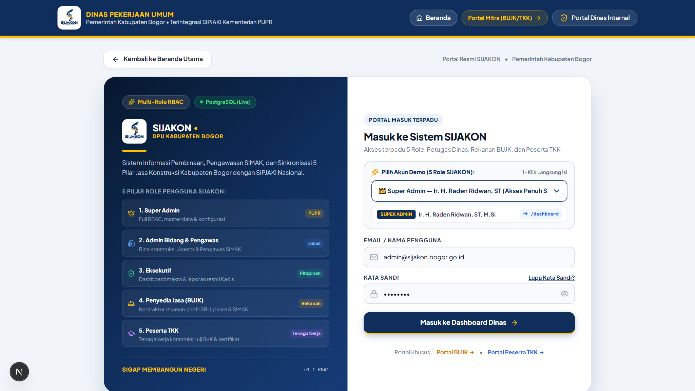
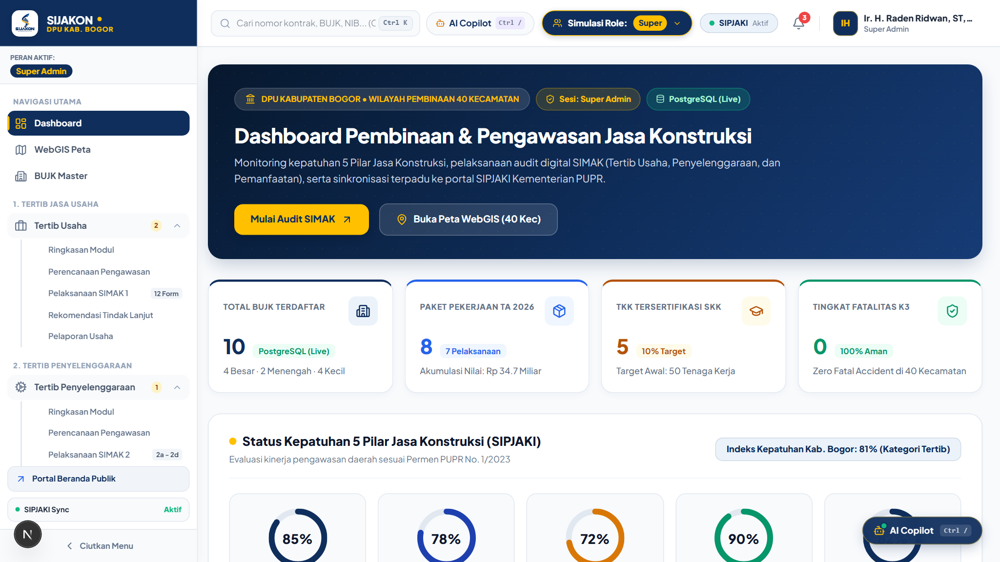
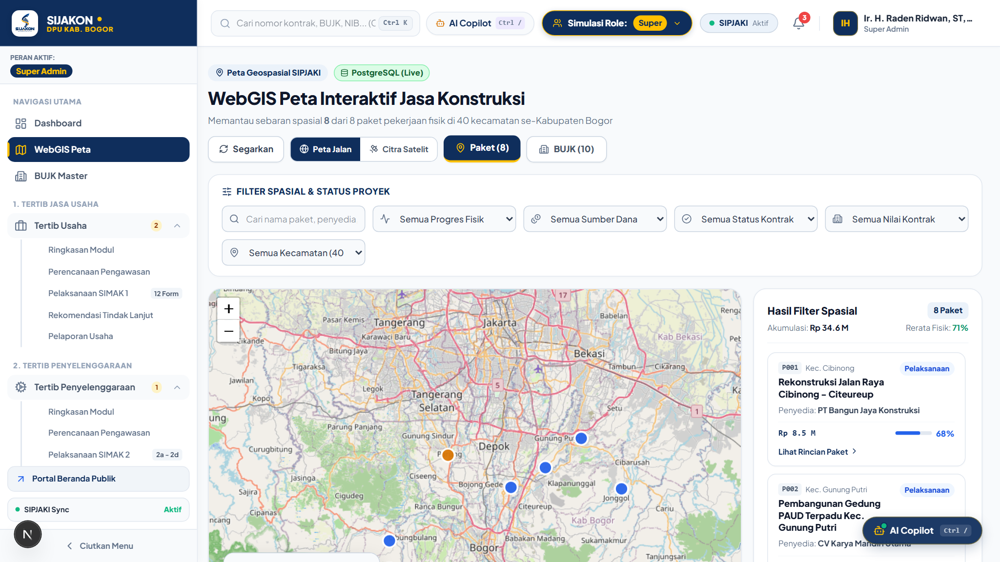
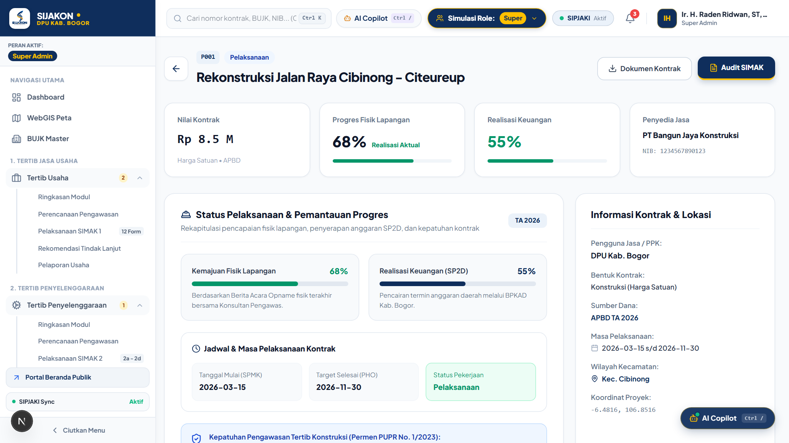
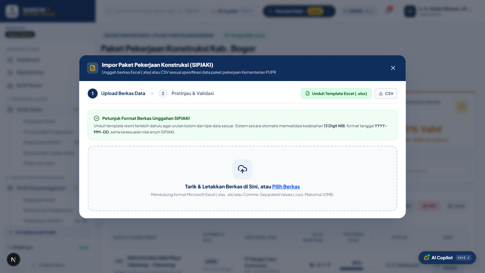
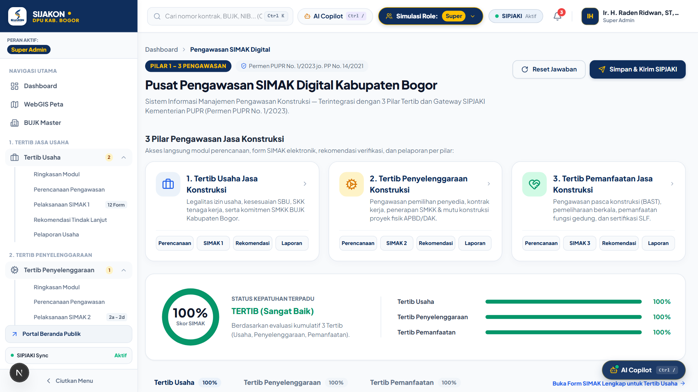
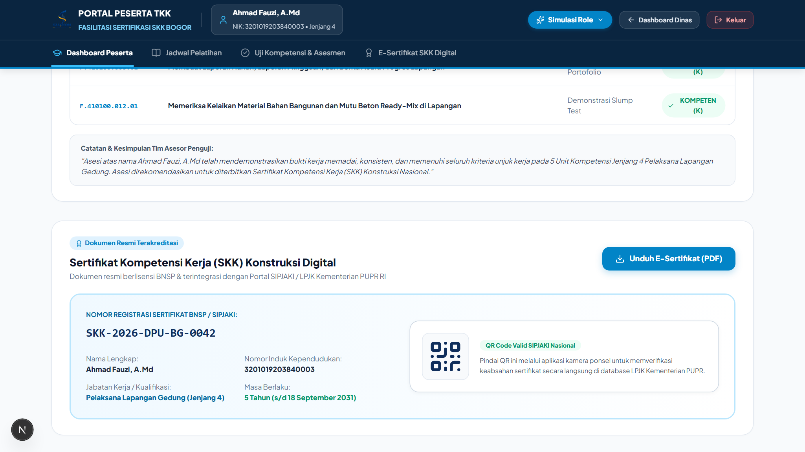
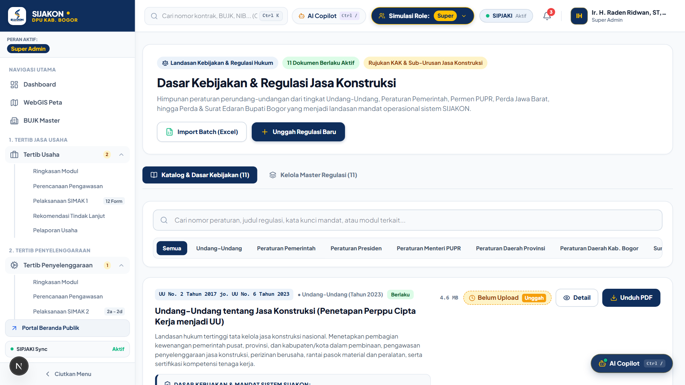

# PANDUAN TEKNIS SIMULASI & EKSPLORASI PURWARUPA SISTEM
## Petunjuk Pengujian Fungsional dan Skenario Perancangan SIJAKON Kabupaten Bogor TA 2026

---

> [!IMPORTANT]
> **KLAUSUL STATUS SISTEM (PROTOTYPE DISCLAIMER):**  
> Dokumen ini disusun sebagai **Panduan Teknis Simulasi & Eksplorasi Purwarupa (*Interactive Functional Prototype Walkthrough*)**, **BUKAN** Buku Petunjuk Operasional (*User Manual*) untuk perangkat lunak yang telah selesai atau operasional penuh. Aplikasi **SIJAKON Kabupaten Bogor** saat ini berada dalam **fase perancangan arsitektur dan pembuktian konsep (*proof-of-concept*)**, yang beroperasi menggunakan data tiruan terstandarisasi (*mock state data*) untuk menguji logika bisnis, hierarki hak akses peran, serta antarmuka pengguna sebelum memasuki tahap pengembangan sistem produksi (*production backend*).

---

### DAFTAR INFORMASI DOKUMEN & AKSES PENGUJIAN

| Parameter | Keterangan Dokumen & Akses |
| :--- | :--- |
| **Instansi Pemilik** | Dinas Pekerjaan Umum dan Penataan Ruang (PUPR) Kabupaten Bogor |
| **Bidang Teknis** | Seksi Bina Konstruksi — Bidang Jasa Konstruksi |
| **Tahun Anggaran** | 2026 |
| **Versi Purwarupa** | v0.8.5 — *Interactive Functional Prototype* |
| **Akses Live Demo Vercel** | 🌐 [https://prototype-bogor.vercel.app/](https://prototype-bogor.vercel.app/) |
| **Status Aksesibilitas** | Siap diakses langsung melalui peramban Desktop/Laptop maupun Smartphone |
| **Basis Teknologi** | Next.js 14 App Router, TypeScript, Tailwind CSS, Leaflet WebGIS |

---

## BAB I: STATUS PENGEMBANGAN & LINGKUP PERANCANGAN

### 1.1 Latar Belakang & Urgensi Perancangan
Kabupaten Bogor memiliki wilayah kewenangan yang sangat luas, mencakup 40 kecamatan dan lebih dari 400 desa/kelurahan dengan intensitas proyek infrastruktur fisik APBD/DAK yang sangat masif setiap tahunnya. Dalam tata kelola jasa konstruksi di daerah, terdapat 4 tantangan utama yang melatarbelakangi perancangan sistem ini:

1. **Fragmentasi Data Penyelenggaraan Konstruksi:**  
   Data paket pekerjaan fisik tersebar di berbagai Organisasi Perangkat Daerah (OPD) teknis (DPUPR, Disdik, Dinkes, Disperkim) tanpa adanya satu pangkalan data pemantauan terpusat (*single source of truth*).
2. **Keterlambatan Deteksi Dini Deviasi Proyek:**  
   Monitoring fisik lapangan dan serapan keuangan seringkali terlambat diidentifikasi hingga mendekati akhir tahun anggaran, yang memperbesar risiko pekerjaan mangkrak atau SiLPA tinggi.
3. **Mandat Pengawasan 3 Tertib (Permen PUPR No. 1/2023):**  
   Pemerintah Kabupaten memiliki kewajiban regulatif untuk melaksanakan pembinaan dan audit kepatuhan terhadap **Tertib Usaha**, **Tertib Penyelenggaraan**, dan **Tertib Pemanfaatan Jasa Konstruksi**.
4. **Pencapaian Target Sertifikasi Tenaga Kerja Konstruksi (TKK):**  
   Target fasilitasi pemenuhan pekerja konstruksi bersertifikat kompetensi nasional (SKK) memerlukan sistem pencatatan yang akuntabel, dapat diverifikasi di lapangan secara cepat, dan terintegrasi dengan SIPJAKI Kementerian PUPR.

### 1.2 Batasan Lingkup Purwarupa (*Prototype Scope*)
Purwarupa fungsional ini dirancang dengan arsitektur **Hybrid Dual-Engine** yang memadukan keandalan visual dengan kesiapan integrasi backend:
- **Telah Berfungsi (*Implemented in System*):** 
  * Seluruh antarmuka pengguna (UI) dan alur navigasi 5 role pengguna.
  * **Konektivitas Basis Data Cloud:** Sistem **sudah terhubung aktif ke basis data cloud relasional (PostgreSQL)** untuk persistensi profil pengguna, manajemen otentikasi, dan audit log.
  * Visualisasi spasial WebGIS 40 kecamatan dan sebaran 10 titik BUJK.
  * Formulir instrumen audit kepatuhan 3 Tertib SIMAK (Permen PUPR 1/2023).
  * Mesin impor berkas Excel dengan *smart-fallback* dan *Universal Header Resolver*.
  * Pencarian regulasi berbasis asisten cerdas AI Copilot.
  * Simulasi penerbitan e-Sertifikat digital ber-QR Code dengan mekanisme verifikasi pra-cetak.
- **Dalam Tahap Pengembangan Lanjutan (*Next Milestone*):** Integrasi *Single Sign-On* (SSO) Satu Data Pemerintah Kabupaten Bogor dan optimalisasi format ekspor berkas data terstandarisasi SIPJAKI Kementerian PUPR.

---

## BAB II: ARSITEKTUR HAK AKSES & PANDUAN 5 AKUN SIMULASI

Untuk menjamin pemisahan kewenangan (*segregation of duties*) dan tata kelola keamanan informasi, SIJAKON menerapkan kontrol akses berbasis peran (*Role-Based Access Control / RBAC*). Pada purwarupa ini, penguji dapat beralih peran secara instan menggunakan fitur **Dropdown Selector Akun Demo** pada halaman login.


*Gambar 2.1: Antarmuka Halaman Login SIJAKON dilengkapi Dropdown Pemilih Akun Demo 5 Role*

### 2.1 Matriks Kewenangan 5 Peran Utama

| No | Peran (Role) | Profil Akun Demo | Lingkup Hak Akses & Kewenangan Utama |
| :-: | :--- | :--- | :--- |
| **1** | **Super Admin** | **Ir. H. Raden Ridwan, ST**<br>*(Administrator Sistem Dinas)* | Akses mutlak seluruh modul, manajemen akun pengguna, pengaturan sistem, konfigurasi master data OPD, dan audit riwayat data (*audit trail*). |
| **2** | **Admin Bidang & Pengawas** | **Bayu Pratama, S.Kom**<br>*(Seksi Bina Konstruksi)*<br>**Ir. Supriyatna, ST**<br>*(Asesor & Pengawas SIMAK)* | Mengelola instrumen audit kepatuhan 3 Tertib, verifikasi berkas paket pekerjaan, input nilai asesmen pelatihan TKK, dan ekspor laporan SIPJAKI. |
| **3** | **Eksekutif Pimpinan** | **Drs. H. Suryanto Putra, M.Si**<br>*(Kepala Dinas PUPR)* | Akses *Read-Only* ke seluruh dashboard pimpinan, pemantauan spasial WebGIS 40 kecamatan, indikator makro serapan APBD, dan ringkasan eksekutif. |
| **4** | **Penyedia Jasa (BUJK)** | **Budi Santoso, ST**<br>*(PT Bangun Jaya Konstruksi)* | Portal khusus mitra rekanan: pembaharuan profil SBU/NIB, pelaporan berkala kemajuan proyek yang dikerjakan, dan pengunggahan berkas BAST. |
| **5** | **Peserta Pelatihan TKK** | **Ahmad Fauzi, A.Md**<br>*(Pelaksana Lapangan Gedung)* | Portal mandiri tenaga kerja: pemantauan kurikulum 32 JP, hasil uji kompetensi asesor BNSP, dan pengunduhan e-Sertifikat digital ber-QR Code. |

### 2.2 Cara Memulai Simulasi Sesi Pengujian
1. Buka peramban dan navigasikan ke tautan resmi purwarupa Vercel:  
   🌐 **URL Demo Vercel:** [https://prototype-bogor.vercel.app/login](https://prototype-bogor.vercel.app/login)
2. Pada panel formulir login, perhatikan bagian **Pilih Akun Cepat (Mode Simulasi Demo)**.
3. Klik kotak dropdown selector, lalu pilih profil peran yang ingin diuji (misal: *👑 Super Admin* atau *🛡️ Eksekutif Pimpinan*).
4. Sistem secara otomatis mengisi kredensial demo dan menampilkan pill profil tujuan beserta rute halaman (`/dashboard`, `/portal/bujk`, atau `/portal/peserta`).
5. Klik tombol **Masuk ke Dashboard Dinas** untuk memulai eksplorasi fitur.

---

## BAB III: PANDUAN SKENARIO SIMULASI PER MODUL (STEP-BY-STEP WALKTHROUGH)

Berikut adalah panduan skenario pengujian langkah-demi-langkah pada seluruh modul utama SIJAKON:

---

### 3.1 Skenario 1 — Dashboard Eksekutif & Ringkasan Realisasi APBD
* **Tujuan Pengujian:** Memvalidasi penyajian indikator makro bagi pimpinan daerah tanpa harus membaca berkas administrasi tebal.
* **Tautan Langsung:** 🌐 [Buka Halaman Dashboard Eksekutif di Vercel](https://prototype-bogor.vercel.app/dashboard)


*Gambar 3.1: Tampilan Executive Dashboard dengan 4 Kartu Metrik Makro dan Tabel Proyek Strategis*

#### Langkah Pengujian:
1. Masuk sebagai peran **Eksekutif Pimpinan** atau **Super Admin**.
2. Perhatikan 4 kartu metrik makro di bagian atas:
   - *Total Paket Aktif TA 2026*: Menampilkan akumulasi seluruh paket fisik yang sedang berjalan.
   - *Total Nilai Kontrak APBD*: Menampilkan pagu anggaran dan nilai kontrak terkontrak.
   - *Badan Usaha (BUJK) Terdaftar*: Menampilkan jumlah kontraktor/konsultan yang terdaftar di database daerah.
   - *Realisasi Sertifikasi TKK*: Menampilkan persentase pencapaian target tahunan fasilitasi tenaga kerja.
3. Gulir ke bawah untuk melihat tabel **5 Proyek Strategis Berjalan Terbesar**. Perhatikan perbandingan antara kurva deviasi progres fisik (%) dengan realisasi pencairan keuangan SP2D (%).

---

### 3.2 Skenario 2 — WebGIS Spasial 40 Kecamatan & Sebaran 10 BUJK
* **Tujuan Pengujian:** Menguji visualisasi geografis interaktif, filter sumber dana, serta akurasi pemetaan titik BUJK dan paket pekerjaan fisik.
* **Tautan Langsung:** 🌐 [Buka Peta WebGIS Spasial di Vercel](https://prototype-bogor.vercel.app/webgis)


*Gambar 3.2: Peta Spasial Interaktif WebGIS Kabupaten Bogor dengan Kontrol Layer dan Titik Koordinat BUJK*

#### Langkah Pengujian:
1. Buka menu **Peta WebGIS** pada bilah navigasi utama.
2. Perhatikan panel kontrol layer di sisi kanan atas peta:
   - Centang opsi **Layer BUJK**: Peta akan menampilkan **10 titik sebaran Badan Usaha Jasa Konstruksi** di Kabupaten Bogor sesuai data master (terdiri atas 4 Kualifikasi Besar, 2 Menengah, dan 4 Kecil).
   - Centang opsi **Layer Paket Konstruksi**: Peta akan memunculkan sebaran titik proyek fisik OPD.
3. Klik salah satu ikon pin pada peta untuk membuka jendela pop-up informasi:
   - Menampilkan nama perusahaan / nama paket pekerjaan.
   - Menampilkan kualifikasi usaha, alamat kantor, penanggung jawab badan usaha, dan tautan langsung ke halaman detail profil.
4. Uji fitur pembesaran (*zoom-in/zoom-out*) dan navigasi batas administratif 40 kecamatan.

---

### 3.3 Skenario 3 — Manajemen Paket Pekerjaan & Pengujian Batch Import Excel
* **Tujuan Pengujian:** Menguji keterbukaan data teknis kontrak proyek serta keandalan mesin impor data massal (*batch import*) tanpa error redundansi kolom.
* **Tautan Langsung:** 🌐 [Buka Halaman Detail Proyek P001 di Vercel](https://prototype-bogor.vercel.app/paket-pekerjaan/P001) | 🌐 [Katalog Seluruh Paket Pekerjaan](https://prototype-bogor.vercel.app/paket-pekerjaan)


*Gambar 3.3: Halaman Detail Paket Pekerjaan Konstruksi (P001) dengan Status Realisasi Fisik dan Keuangan*


*Gambar 3.4: Modal Batch Import Excel dilengkapi Mesin Universal Header Matching dan Smart Fallback*

#### Langkah Pengujian:
1. Buka menu **Paket Pekerjaan**, lalu klik paket berkode **P001** (*Peningkatan Jalan Ruas Sukaraja - Katulampa*).
2. Perhatikan pembagian data kontrak yang komprehensif: Nomor SPMK, tanggal PHO, nama Pejabat Pembuat Komitmen (PPK), kontraktor pelaksana, konsultan pengawas, dan koordinat GPS.
3. Kembali ke daftar paket, lalu klik tombol **`[📗 Import Excel]`** di pojok kanan atas.
4. Pada modal import yang muncul:
   - Unduh template standar yang telah disediakan sistem.
   - Simulasikan pengunggahan file Excel (.xlsx / .csv).
   - Perhatikan bahwa sistem memiliki **Universal Header Resolver**: meskipun urutan kolom berbeda atau penamaan kepala tabel bervariasi (misal: *"Nama Paket"*, *"Paket Pekerjaan"*, atau *"Kegiatan"*), sistem tetap mengenali kolom tersebut secara otomatis dan mencegah kegagalan migrasi data.

---

### 3.4 Skenario 4 — Simulasi Audit Pengawasan Kepatuhan 3 Tertib (SIMAK)
* **Tujuan Pengujian:** Menguji kesesuaian instrumen pengawasan daerah dengan regulasi nasional **Permen PUPR No. 1/2023**.
* **Tautan Langsung:** 🌐 [Buka Modul Pengawasan SIMAK di Vercel](https://prototype-bogor.vercel.app/pengawasan)


*Gambar 3.5: Formulir Instrumen Audit Tertib Usaha, Tertib Penyelenggaraan, dan Tertib Pemanfaatan*

#### Langkah Pengujian:
1. Masuk sebagai peran **Admin Bidang / Tim Pengawas**.
2. Buka menu **Pengawasan Tertib Konstruksi (SIMAK)**.
3. Eksplorasi 3 pilar instrumen audit kepatuhan:
   - **Tertib Usaha:** Pemeriksaan keabsahan NIB, kualifikasi SBU, izin berusaha, dan kepatuhan asosiasi.
   - **Tertib Penyelenggaraan:** Audit dokumen pemilihan penyedia, kontrak kerja konstruksi, pemenuhan standar mutu, penerapan Sistem Manajemen Keselamatan Konstruksi (SMKK/K3), dan keabsahan sertifikat TKK di lapangan.
   - **Tertib Pemanfaatan:** Evaluasi kelaikan fungsi bangunan fisik gedung/jalan, pemeliharaan berkala, dan kepemilikan Sertifikat Laik Fungsi (SLF).
4. Perhatikan kalkulator otomatis indeks skor kepatuhan dan penerbitan formulir rekomendasi tindak lanjut bagi dinas.

---

### 3.5 Skenario 5 — Simulasi Pelatihan & e-Sertifikat Digital Tenaga Kerja (TKK)
* **Tujuan Pengujian:** Memvalidasi alur pembinaan tenaga kerja, penilaian kompetensi oleh asesor BNSP, dan keabsahan verifikasi sertifikat di lapangan melalui QR Code.
* **Tautan Langsung:** 🌐 [Buka Portal Mandiri Peserta TKK di Vercel](https://prototype-bogor.vercel.app/portal/peserta)


*Gambar 3.6: Dashboard Peserta Pelatihan TKK memuat Riwayat 32 JP, Hasil Asesor, dan e-Sertifikat QR Code SIPJAKI*

#### Langkah Pengujian:
1. Masuk ke halaman login, pilih peran **🎓 Peserta TKK (Ahmad Fauzi, A.Md)**, lalu klik masuk.
2. Penguji akan langsung diarahkan ke **Portal Khusus Peserta** (`/portal/peserta`).
3. Perhatikan 4 tahapan evaluasi peserta:
   - *Agenda Kurikulum (32 JP)*: 4 sesi materi terstruktur dari SMKK/K3 hingga administrasi pelaporan proyek.
   - *Hasil Uji Kompetensi Asesor BNSP*: Keputusan status kompeten (K) pada 5 unit standar kompetensi SKKNI.
4. Gulir ke bagian **E-Sertifikat SKK Digital**:
   - Terdapat nomor registrasi sertifikat resmi, masa berlaku 5 tahun, dan cap digital Dinas PUPR.
   - **Fitur QR Code Validasi:** Setiap sertifikat memiliki kode QR dinamis yang dapat dipindai oleh pengawas lapangan untuk membuktikan keaslian identitas tenaga kerja secara publik di portal SIPJAKI.
   - **Mekanisme Konfirmasi Data Pra-Cetak:** Demi menjaga integritas data dan mencegah pergantian identitas / joki sertifikat, NIK dan skema keahlian dikunci secara permanen (*read-only*), sementara perbaikan salah ketik nama/gelar wajib melalui pengajuan bukti scan e-KTP kepada panitia dinas.

---

### 3.6 Skenario 6 — Asisten Cerdas AI Copilot & Repositori Regulasi Jakon
* **Tujuan Pengujian:** Menguji kemampuan asisten kecerdasan buatan (*AI Assistant*) dalam menjawab pertanyaan regulatif berdasarkan korpus 11 peraturan perundang-undangan jasa konstruksi daerah dan nasional.
* **Tautan Langsung:** 🌐 [Buka Halaman Regulasi & AI Copilot di Vercel](https://prototype-bogor.vercel.app/regulasi)


*Gambar 3.7: Panel Asisten AI Copilot Terintegrasi dengan Repositori 11 Dasar Hukum Jasa Konstruksi*

#### Langkah Pengujian:
1. Buka menu **Dasar Hukum & Regulasi** atau klik ikon widget **AI Copilot** di pojok kanan bawah layar.
2. Perhatikan repositori digital yang memuat 11 dokumen hukum lengkap:
   - UU No. 2 Tahun 2017 tentang Jasa Konstruksi.
   - PP No. 14 Tahun 2021 tentang Perubahan PP No. 22 Tahun 2020.
   - Permen PUPR No. 1 Tahun 2023 tentang Pengawasan Penyelenggaraan Jasa Konstruksi.
   - Perda Kabupaten Bogor No. 2 Tahun 2020 tentang Penyelenggaraan Jasa Konstruksi di Daerah.
3. Pada kolom percakapan AI Copilot, ketik contoh pertanyaan:  
   * *"Apa sanksi administratif jika kontraktor tidak menerapkan K3 Konstruksi?"*  
   * *"Apa dasar hukum pembinaan tenaga kerja konstruksi oleh Pemerintah Kabupaten?"*
4. Amati jawaban instan asisten yang dilengkapi rujukan pasal dan kutipan resmi perundang-undangan.

---

## BAB IV: DISKLAIMER TEKNIS: DATA SIMULASI VS TARGET SISTEM PRODUKSI

Untuk menjamin transparansi teknis di hadapan pimpinan dinas dan dewan penguji, tabel berikut memetakan batasan antara purwarupa saat ini dengan arsitektur sistem pada fase produksi:

| Komponen Sistem | Status Purwarupa Saat Ini (*Prototype State*) | Target Fase Sistem Produksi (*Production Target*) |
| :--- | :--- | :--- |
| **Penyimpanan Data** | **Hybrid Dual-Engine:** Terhubung aktif ke basis data cloud (PostgreSQL) untuk persistensi data pengguna dan profil dinas, didukung sesi demo peramban untuk kenyamanan uji coba interaktif. | Pangkalan data terpusat **PostgreSQL 16 Enterprise** dengan ekstensi spasial **PostGIS** di infrastruktur Data Center Diskominfo Kab. Bogor. |
| **Keamanan & Autentikasi** | **Autentikasi Cloud & JWT Enkripsi:** Hak akses terkelola via RBAC 5 Role dengan fitur pemilihan akun demo untuk kemudahan pengujian. | Integrasi penuh dengan **Single Sign-On (SSO) Satu Data Kab. Bogor** (OAuth2/SAML) dan verifikasi 2-faktor (2FA). |
| **Peta Spasial (GIS)** | Peta vektor OpenStreetMap / CartoDB dengan layer GeoJSON spasial 40 kecamatan & 10 titik BUJK terverifikasi | **GeoServer / PostGIS Spasial Server** dengan layer spasial terintegrasi RTRW Bappedalitbang & Kantor Pertanahan (ATR/BPN). |
| **Sinkronisasi SIPJAKI** | Ekspor berkas format Excel (.xlsx multi-sheet) terstandarisasi SIPJAKI Kementerian PUPR | Pemantapan format ekspor berkas data terstruktur (.xlsx/.csv) terstandarisasi SIPJAKI siap unggah secara berkala oleh operator dinas ke portal pembinaan nasional SIPJAKI Kementerian PUPR. |
| **Penyimpanan Berkas** | Penyimpanan berkas cloud dan buffer lokal untuk lampiran uji coba | Sistem penyimpanan objek cloud (Object Storage) terpusat dengan enkripsi dokumen kontrak dan BAST. |

---

## BAB V: PANDUAN PEMECAHAN MASALAH (TROUBLESHOOTING & FAQ)

### 5.1 Pertanyaan Umum Seputar Sesi Uji Coba (FAQ)

1. **"Apakah data yang diinput tersimpan secara permanen ke basis data cloud atau hanya sementara?"**  
   *Penjelasan:* Sistem SIJAKON dirancang dengan arsitektur **Hybrid Dual-Mode**:  
   - **Mode Terhubung Cloud:** Ketika sistem beroperasi dengan akun pengguna terdaftar, seluruh data profil dinas, perubahan status, dan catatan audit **tersimpan secara permanen dan riil di basis data cloud (PostgreSQL)**.  
   - **Mode Akun Demo Cepat:** Khusus pada sesi simulasi menggunakan dropdown akun demo (misal: profil *Ir. H. Raden Ridwan, ST*), sistem mengisolasi modifikasi data ke sesi lokal peramban (*client session*). Hal ini dirancang sengaja agar beberapa evaluator yang menguji sistem secara bersamaan di tempat berbeda tidak saling merusak atau menimpa data master perancangan, sehingga setiap sesi pengujian selalu bersih (*clean testbed state*).

2. **"Apakah peta WebGIS memerlukan koneksi internet?"**  
   *Penjelasan:* Ya, pemuatan ubin peta (*map tiles*) OpenStreetMap membutuhkan akses internet. Namun jika dijalankan di jaringan lokal tertutup (*intranet dinas*), sistem dapat dikonfigurasikan menggunakan *offline tile cache*.

3. **"Bagaimana jika format file Excel yang saya unggah memiliki kolom tambahan?"**  
   *Penjelasan:* Mesin *Universal Header Resolver* SIJAKON secara cerdas akan memetakan kolom wajib (seperti Nama Paket, Nilai Kontrak, OPD) dan mengabaikan kolom tambahan yang tidak relevan tanpa membatalkan proses impor.

---

## BAB VI: LEMBAR EVALUASI UJI PENERIMAAN PURWARUPA (PROTOTYPE UAT SHEET)

Lembar evaluasi ini disediakan bagi evaluator, tim penguji, dan calon pengguna untuk memberikan penilaian kelayakan perancangan sebelum memasuki tahap pengadaan/pengembangan teknis produksi.

### 6.1 Rubrik Penilaian Pengujian Antarmuka & Alur Bisnis

| No | Komponen yang Diuji | Parameter Penilaian | Skor (1 - 5) | Catatan / Rekomendasi |
| :-: | :--- | :--- | :---: | :--- |
| **1** | **Kemudahan Navigasi** | Kejelasan tata letak menu, kemudahan beralih akun 5 role, dan responsivitas antarmuka. | [ &nbsp; ] | |
| **2** | **Visualisasi WebGIS** | Ketepatan sebaran 10 titik BUJK, kontrol layer, dan keterbacaan data proyek di 40 kecamatan. | [ &nbsp; ] | |
| **3** | **Modul Paket Pekerjaan** | Kelengkapan data kontrak SPMK/PHO dan kemudahan impor batch data Excel dinas. | [ &nbsp; ] | |
| **4** | **Instrumen 3 Tertib (SIMAK)** | Keselarasan kriteria audit kepatuhan dengan regulasi Permen PUPR No. 1/2023. | [ &nbsp; ] | |
| **5** | **Sertifikasi Tenaga Kerja (TKK)** | Kejelasan alur kurikulum 32 JP, pembuktian kompetensi asesor, dan fitur e-Sertifikat ber-QR Code. | [ &nbsp; ] | |
| **6** | **Asisten Cerdas AI Copilot** | Akurasi jawaban regulasi dan kecepatan pencarian 11 dokumen dasar hukum jakon. | [ &nbsp; ] | |

### 6.2 Formulir Masukan Penyempurnaan Rancangan
* **Nama Penguji / Evaluator:** _____________________________________________
* **Jabatan / Instansi:** _____________________________________________
* **Tanggal Pengujian:** _____________________________________________
* **Masukan Perbaikan UI/UX:**  
  _________________________________________________________________________
* **Masukan Alur Regulasi & Validasi Data:**  
  _________________________________________________________________________
* **Rekomendasi Akhir:** `[  ] Layak Dilanjutkan ke Produksi` &nbsp;&nbsp;&nbsp; `[  ] Perlu Penyesuaian Desain`

---

## BAB VII: ROADMAP PENYELESAIAN SISTEM (TIMELINE 5 BULAN MENUJU GO-LIVE)

Rencana aksi implementasi menuju peluncuran resmi (*official go-live*) SIJAKON Kabupaten Bogor terbagi ke dalam 4 fase strategis:

```
[Bulan 1] ───► FASE 1: PERSIAPAN & LEGAL DRAFTING
               • Finalisasi SOP Pengawasan Bersama Diskominfo & Bagian Hukum
               • Penyusunan draf Surat Edaran Sekda ttg Integrasi Data Jasa Konstruksi

[Bulan 2-3] ──► FASE 2: ENGINEERING & DATABASE INTEGRATION
               • Pembangunan RESTful API & Relasional Database PostgreSQL PostGIS
               • Migrasi data awal master BUJK & katalog proyek OPD

[Bulan 4] ───► FASE 3: PILOT TESTING & BIMTEK OPERATOR
               • Uji coba operasional pada 3 OPD pilot (DPUPR, Disdik, Dinkes)
               • Pelatihan teknis bagi PPK, Konsultan Pengawas, dan Asosiasi BUJK

[Bulan 5] ───► FASE 4: SOFT LAUNCHING & INTEGRASI NASIONAL
               • Peresmian operasional (*Soft Launching*) oleh Pimpinan Daerah
               • Aktivasi sinkronisasi rutin pelaporan ke portal SIPJAKI Kementerian PUPR
```

---

*Disusun secara terpadu oleh Tim Perancangan Sistem Informasi Jasa Konstruksi (SIJAKON) Dinas Pekerjaan Umum dan Penataan Ruang (PUPR) Kabupaten Bogor TA 2026.*
